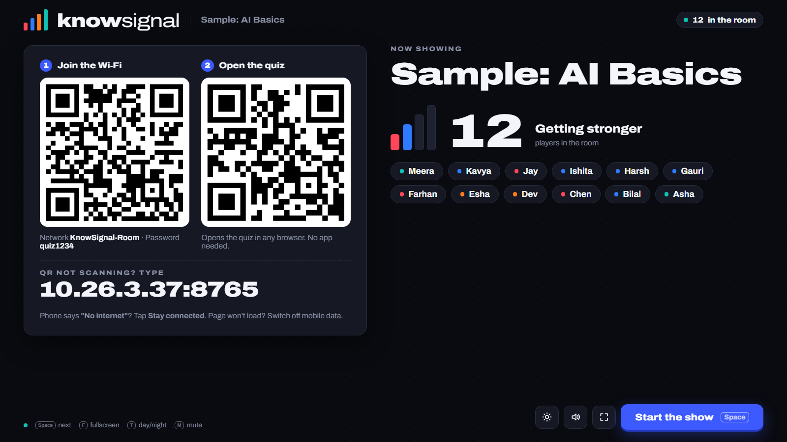
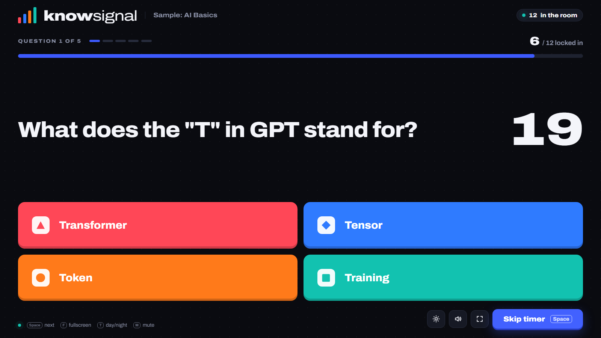
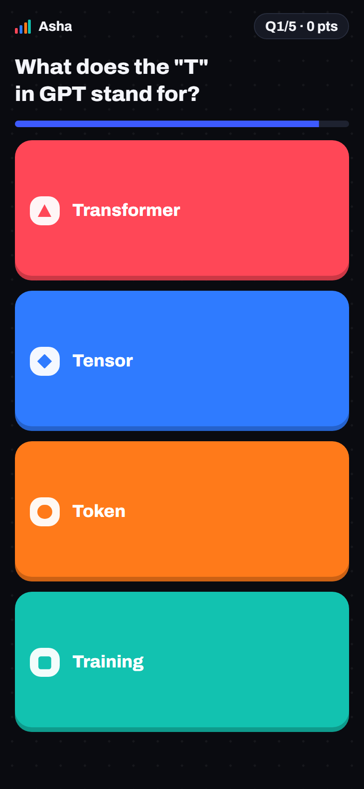
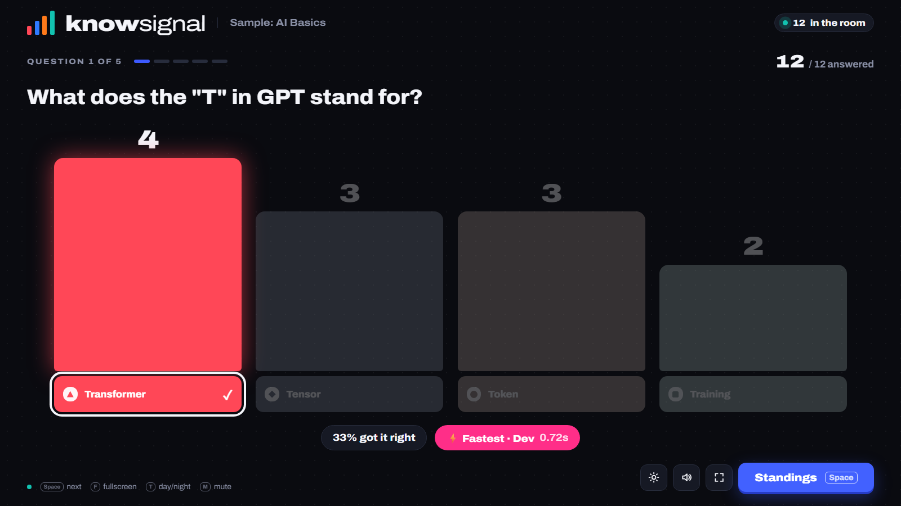
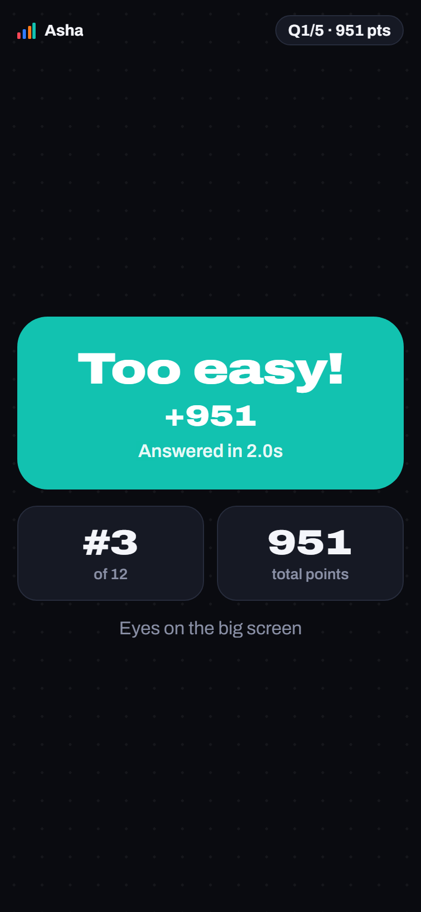
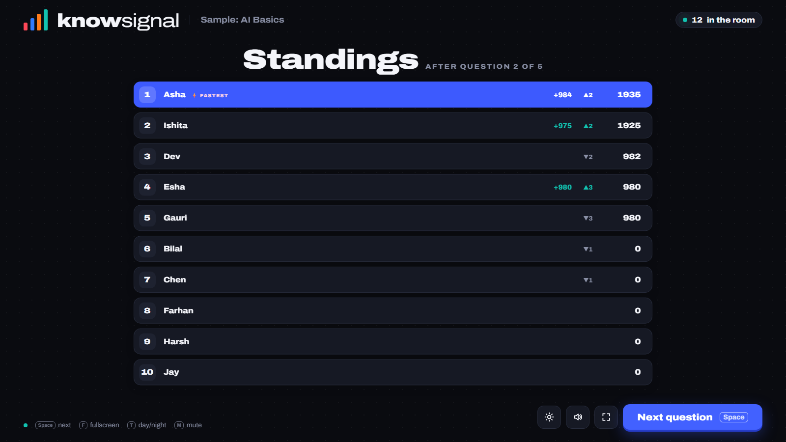
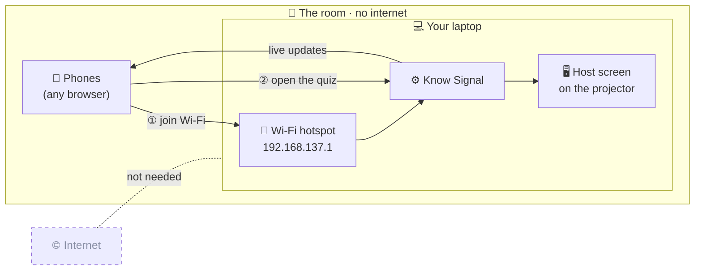
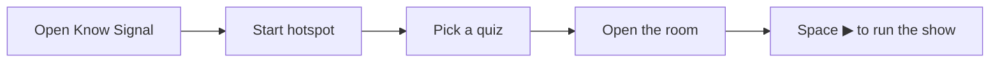

<h1 align="center">Know Signal</h1>

<p align="center"><b>Out of range. Never out of answers.</b></p>

<p align="center">
A live, Mentimeter-style quiz that runs entirely on your laptop.<br>
The room joins your laptop's own Wi‑Fi and plays in any phone browser.<br>
<b>No internet · No sign-ups · No player caps · No app to install</b>
</p>

---

**Why it exists.** Mentimeter-style quizzes need the internet, and the free plan caps participants. In many lecture halls the Wi‑Fi dies and phones drop to zero bars, so the quiz never loads. Know Signal makes the laptop the network: no internet needed, ever.

## A game, start to finish

### 1 · Open the room



- **Two scans to join.** QR 1 connects phones to the laptop's hotspot; QR 2 opens the quiz. A big typeable address is the fallback.
- **The room signal meter** fills as people arrive: *Searching for signal… → Weak → Getting stronger → Strong → Full signal*.
- **Nicknames pop in live.** Click a name to remove it.
- **Teams mode** (optional): one phone per group, for rooms bigger than the hotspot.

### 2 · Race the clock

<table>
  <tr>
    <td width="72%"></td>
    <td width="28%"></td>
  </tr>
</table>

- **3‑2‑1, then go.** The question lands first and the options appear after the countdown, so everyone reads before racing.
- **2–4 options, 10–90 second timer** per question, with countdown music and last-five-seconds ticks.
- **Phones show the full question.** One tap locks the answer in, and the chosen colour fills the screen.
- **Live "locked in" count** on the projector. The question ends early once everyone has answered.
- **Speed scoring.** A correct answer earns 1000 points if instant, down to 500 at the buzzer. Wrong answers earn 0.

### 3 · The reveal

<table>
  <tr>
    <td width="72%"></td>
    <td width="28%"></td>
  </tr>
</table>

- **The right answer glows.** The others fade to grey, and the bars show how the room voted.
- **Callouts:** *% got it right* and *⚡ Fastest · name · time*.
- **Every phone gets its own result**: correct or not, points, answer time, rank and total.

### 4 · Standings



- **A three-beat animation.** The previous standings appear first, this round's points count up, then rows swap places.
- **▲/▼ movement** for each player, and the round's quickest correct answer is tagged *⚡ fastest*.

### 5 · The finale


- **Suspense finish** (on by default, opt out on the setup screen). No standings after the second-to-last question, and phones hide ranks, so nobody knows who's won until the podium.
- **The podium rises 3 → 2 → 1** to a drumroll, fanfare and confetti, with places 4–10 shown below.
- **One-click CSV export** of the standings and every answer. Results also autosave to the results folder.

## Also built in

- **Night and Day themes.** Press **T** when a projector in a bright room washes out the dark screen.
- **Rejoin keeps your score.** A refresh, dropped connection or phone sleep won't cost a player their points.
- **Browser quiz editor** at `/edit`, with JSON import and export.
- **Sound is synthesised in the browser.** No audio files; press **M** to mute.
- **Host controls stay on the laptop.** Participants can't open `/host` or `/edit`.
- **One installer, nothing else to install.** About 8 MB with Python built in; the Archivo font is bundled (SIL Open Font License).

## How it works without internet



| | |
|---|---|
| **The network** | Your laptop's own Wi‑Fi hotspot. Phones join it like any Wi‑Fi. |
| **The quiz** | Served by the laptop and opened in each phone's browser. |
| **The internet** | Never used. A built-in virtual adapter lets Windows run a hotspot with zero connectivity. |
| **Capacity** | Windows allows 8 devices by default; setup raises this to 128. In practice, **30–60 phones** depending on the Wi‑Fi card. Bigger room? Use **Teams mode**. |

## Install (once, about 2 minutes)

1. Download and run **`KnowSignal-Setup.exe`**.
2. Approve the single Windows admin prompt. Setup prepares the laptop to host offline:
   - raises the hotspot limit from 8 to 128 devices
   - lets Know Signal through the firewall
   - adds the virtual adapter that lets the hotspot run with no internet
3. Launch **Know Signal** from the Start menu or desktop.

> **"Windows protected your PC"?** The installer isn't code-signed yet. Click **More info → Run anyway**.

## On the day



1. **Turn Wi‑Fi on** (it doesn't need to connect to anything) and open **Know Signal**. It opens in its own window; drag it to the projector and press **F**.
2. **Start hotspot.** Set a name and password once; the switch remembers them.
3. **Pick a quiz → Open the room.** People scan QR 1 (Wi‑Fi), then QR 2 (quiz), and type a nickname.
4. **Press Space** to move through it: question → reveal → standings → … → podium.
5. **Results** are saved automatically. Download the CSVs on the podium screen, or click **Open results folder**.

Tell participants: if the phone says **"No internet"**, tap **Stay connected**. If the page won't load, turn off mobile data.

| Key | Action |
|---|---|
| Space / Enter / → | Next step (start, skip timer, reveal, standings, next question) |
| F | Fullscreen |
| M | Mute |
| T | Day / night theme |

**Where things live:** quizzes and results are in `Documents\Know Signal`. Settings and logs are in `%LOCALAPPDATA%\KnowSignal`.

## Writing quizzes

Open **Create or edit quizzes** on the setup screen. Quizzes are saved as JSON in `Documents\Know Signal\quizzes` (in `quizzes/` when running from source); you can export and import them, or write them by hand:

```json
{ "title": "My quiz", "questions": [
  { "text": "Question?", "options": ["A", "B", "C", "D"], "correct": 0, "time": 20 }
] }
```

## Other ways to connect

- **A college LAN or Wi‑Fi that works locally but has no internet.** Skip the hotspot. Connect the laptop to that network and pick its address on the host screen.
- **An Android phone hotspot with mobile data off.** Connect the laptop to it too and pick the laptop's address. It's limited to about 10 devices.

## For developers

### Project layout

```
know-signal-offline-quiz/
├── src/              the app
│   ├── app.py            desktop launcher: one instance, Edge app window, --setup / --unsetup
│   ├── server.py         HTTP + live-update server, quiz storage, CSV export
│   ├── quiz_engine.py    game rules: phases, scoring, suspense, standings
│   ├── hotspot.py        start, stop and read the Windows hotspot
│   ├── windows_setup.py  one-time admin setup run by the installer
│   └── static/           host, phone and editor screens (HTML/CSS/JS, font, QR library)
├── quizzes/          sample quiz (your quizzes are saved here when running from source)
├── scripts/          run-from-source and rehearsal helpers
├── packaging/        app icon, PyInstaller build and Inno Setup installer
├── tests/            game-logic tests
└── docs/             brand guide and README screenshots
```

### Run from source

Python 3.9+, standard library only. Run these from this folder:

```powershell
.\scripts\setup-once.ps1      # once, as Administrator: hotspot limit, firewall, adapter
.\scripts\start-hotspot.ps1   # or use the switch on the setup screen
.\scripts\start-quiz.bat      # serves on port 80 (falls back to 8080) and opens the host screen
```

Results and settings land in `results/` and `config.json` here (both git-ignored). `src\server.py` also accepts `--port` and `--no-browser`.

### Build the installer

Needs Inno Setup 6 (`winget install JRSoftware.InnoSetup`):

```powershell
.\packaging\build.ps1 -Version 1.0.0   # → dist\KnowSignal-Setup-1.0.0.exe
```

### Rehearsal and testing

`scripts\simulate.py` creates fake phones; it does **not** start the quiz server. The server must already be running, in its own window.

**Rehearse with 40 fake players while you drive the quiz yourself:**
1. Open Know Signal (or run `scripts\start-quiz.bat`) and leave it running.
2. On the host screen, pick a quiz and click **Open the room**.
3. In a **second** terminal, run `python scripts\simulate.py --players 40`. The bots appear in the lobby and answer at random as you drive the quiz. You can join with your real phone too.

**Fully automatic self-test** (server running, no clicking needed):
```powershell
python scripts\simulate.py --players 150 --drive    # opens its own session and advances itself; prints PASS/FAIL
```

The simulator finds the server on port 80, 8080 or 8000 by itself; pass `--url http://127.0.0.1:PORT` for anything else.

**Logic tests** (no server needed): `python -m unittest discover -s tests`

## About the name

*Know Signal* puns on the moment every lecture hall dreads, **"no signal"**, turned into a promise: **know** signal. The logo's four bars read as a signal meter and as a quiz results chart. The full story, palette, type and voice are in the [brand guide](docs/BRAND.md).
